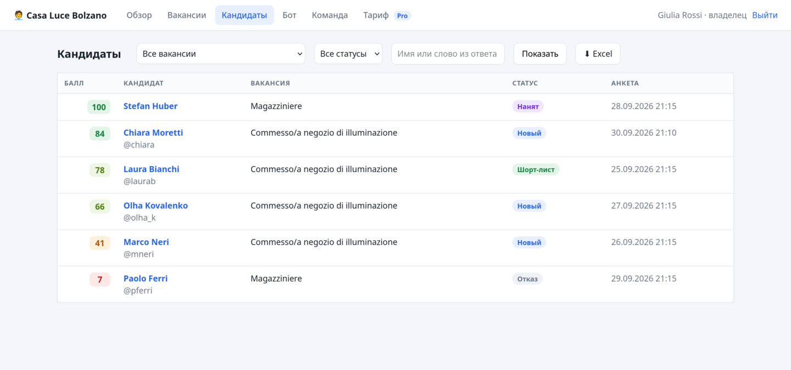

# 🧑‍💼 HR SaaS

<p>
  <a href="https://github.com/sonoyumi/hr-saas/actions/workflows/ci.yml"></a>
  
  
  
  
  
</p>

**🇬🇧 [English](#en)** · **🇮🇹 [Italiano](#it)** · **🇺🇦 [Українська](#uk)** · **🇷🇺 [Русский](#ru)**

<p align="center">
  
  
</p>

---

<a id="en"></a>

## 🇬🇧 English

A candidate-screening **service for many companies**. Each company signs up in a web cabinet, connects its own
Telegram bot and writes vacancy questionnaires as plain text. Candidates answer in Telegram in their own language;
answers are scored (points per option, keywords, optionally Claude) and the recruiter sees everyone ranked by score,
changes statuses, leaves notes and exports Excel. Plans limit vacancies, questionnaires per month and team size.

```
candidate ─ Telegram ─► company's bot ── webhook ──► POST /tg/<bot id>  (secret header, constant-time check)
                                                     │ hub: company by bot id → ONE shared aiogram Dispatcher
                                                     ▼
          SQLite: tenants · users · bots (token encrypted) · vacancies · candidates · answers · notes · FSM
                                                     ▲
recruiter ─ browser ─► cabinet (FastAPI + Jinja2): vacancies editor, ranking, statuses, notes, Excel, team, plan
```

### Features

- **Multi-tenant:** one process and one database serve many companies; every query carries the company id, and
  another company's candidate or vacancy behaves exactly like a missing one (404). Tests check it route by route.
- **Bring your own bot:** the owner pastes a token from @BotFather → checked with `getMe`, stored **encrypted**
  (Fernet, key only in `.env`), webhook set with a random secret; one Dispatcher serves all bots.
- **Questionnaire as text:** `? question` + `- option | points`, `?? open question | keywords`; every mistake is
  reported with its line number; the text goes back into the editor unchanged.
- **Candidate flow:** vacancies of this company only, questions with buttons or text, the bot speaks IT/EN/UK/RU,
  old buttons and double taps are ignored, progress is stored in SQLite (survives restarts and deploys).
- **Scoring 0–100:** points of chosen options + open answers scored 0–10 by keywords, or by **Claude** on Pro and
  Business (structured JSON output, the answer passed as untrusted data, any API problem → keyword score).
- **Cabinet:** dashboard with plan usage and the best new candidates, candidates ranked by score with filters and
  search, candidate card with every answer and its points, statuses (new, shortlist, rejected, hired), team notes,
  Excel export (formula injection neutralised), team with temporary passwords shown once.
- **Plans:** Free / Pro / Business limits for active vacancies, questionnaires per month and users; when the month is
  full, the bot politely pauses applications.
- **Security:** scrypt passwords, signed HttpOnly session cookie, CSRF in every form, login rate limit, strict CSP,
  owner-only actions (bot, team), open-redirect protection.
- **CLI:** `run`, `polling` (a company bot without HTTPS, for development), `create-tenant`, `set-plan`, `tenants`,
  `gen-key`, `check`, `demo`.

### Example

```bash
hr-saas tenants
```

```
адрес            тариф     польз.  вакансий  анкет/мес  бот
casa-luce        pro            1         2      6/500  @hr_700001_bot
studio-rossi     free           1         1       1/30  —
```

Real output after `hr-saas demo` and one candidate who went through Casa Luce's bot via the webhook (the headers are
in Russian: address, plan, users, vacancies, questionnaires this month / limit, bot).

### Quick start

```bash
git clone https://github.com/sonoyumi/hr-saas.git
cd hr-saas
python3 -m venv .venv && source .venv/bin/activate
pip install -e ".[dev]"
cp .env.example .env              # SECRET_KEY, MASTER_KEY (hr-saas gen-key), PUBLIC_URL=https://…
hr-saas check
hr-saas run                       # cabinet on http://127.0.0.1:8098, sign up at /signup
```

Just to look around: `hr-saas demo && hr-saas run`, login `giulia@casaluce.example` / `demo-password-123`.
Without HTTPS on your laptop, run a company's bot with `hr-saas polling casa-luce`.

Tests: `pytest` (49 tests: the questionnaire parser, encryption, settings, plans, keyword and Claude scoring with a fake
client — request shape, clamping, refusals and API errors; tenant isolation everywhere, one questionnaire at a time,
double taps, the monthly counter, FSM surviving a restart; the bot end to end **through the webhook URL** — secret
check, full questionnaire, stale buttons, plan limit, another company's vacancy; the cabinet — sign up, login limit,
escaping, CSRF, statuses, notes, Excel formulas, bot connection, owner-only actions, temporary passwords).
No network, Telegram or Anthropic key needed.

### Project structure

```
src/hr_saas/
├── config.py      # settings from .env, every error at once
├── crypto.py      # Fernet encryption of bot tokens
├── security.py    # scrypt passwords, signed session cookie, CSRF
├── plans.py       # Free / Pro / Business limits
├── questions.py   # questionnaire text ⇄ questions, errors with line numbers
├── store.py       # SQLite: tenants, users, bots, vacancies, candidates, answers, notes (tenant-scoped)
├── fsm.py         # aiogram FSM storage in SQLite
├── scoring.py     # keywords, demo mock, Claude with structured outputs
├── bot.py         # the candidate's side: one router for every company's bot
├── hub.py         # many bots in one process: webhook routing, connect/disconnect, polling
├── export.py      # Excel export
├── web.py         # company cabinet + POST /tg/<bot id>
├── templates/ static/
└── cli.py         # run | polling | create-tenant | set-plan | tenants | gen-key | check | demo
```

### Author

**Vladyslav Shokun** ([@sonoyumi](https://github.com/sonoyumi)), Python developer: Telegram bots, web scraping, automation.

[](https://t.me/sonoyumiii)
[](mailto:sonoyumiii@gmail.com)

> 💼 Need a screening bot for your agency, or a SaaS of your own? Get in touch.

### License

MIT, see [LICENSE](LICENSE).

---

<a id="it"></a>

## 🇮🇹 Italiano

**[🇬🇧 English](#en)** · **🇮🇹 Italiano** · **[🇺🇦 Українська](#uk)** · **[🇷🇺 Русский](#ru)**

Un **servizio di preselezione dei candidati per molte aziende**. Ogni azienda si registra nel pannello web, collega il
proprio bot Telegram e scrive i questionari delle posizioni in testo semplice. I candidati rispondono su Telegram
nella loro lingua; le risposte ricevono un punteggio (punti per opzione, parole chiave, e se attivo Claude) e il
selezionatore vede tutti in classifica, cambia lo stato, aggiunge note ed esporta in Excel. I piani limitano posizioni,
questionari al mese e utenti.

### Funzionalità

- **Multi-azienda:** un solo processo e un solo database; ogni query contiene l'id dell'azienda, i dati di un'altra
  azienda sono invisibili (404).
- **Il bot dell'azienda:** il token di @BotFather viene verificato, salvato **cifrato** e collegato con un webhook
  con segreto.
- **Questionario come testo:** `? domanda` + `- opzione | punti`, `?? domanda aperta | parole chiave`; ogni errore
  indicato con il numero di riga.
- **Punteggio 0–100:** punti delle opzioni + risposte aperte valutate con parole chiave o con **Claude** (piani Pro
  e Business).
- **Pannello:** classifica, filtri e ricerca, scheda del candidato con ogni risposta, stati, note del team, export
  Excel, team con password temporanee mostrate una volta, piani Free / Pro / Business.
- **Sicurezza:** password scrypt, cookie firmato, CSRF, limite ai tentativi di accesso, CSP, token dei bot cifrati.

### Esempio

L'output di `hr-saas tenants` è nella sezione inglese: due aziende demo, piani e utilizzo del mese.

### Avvio rapido

```bash
git clone https://github.com/sonoyumi/hr-saas.git
cd hr-saas
python3 -m venv .venv && source .venv/bin/activate
pip install -e ".[dev]"
cp .env.example .env              # SECRET_KEY, MASTER_KEY (hr-saas gen-key), PUBLIC_URL=https://…
hr-saas run                       # pannello su http://127.0.0.1:8098, registrazione su /signup
```

Solo per vedere: `hr-saas demo && hr-saas run`, accesso `giulia@casaluce.example` / `demo-password-123`.
Test: `pytest` (49 test, senza rete, Telegram o chiave Anthropic).

### Struttura del progetto

```
src/hr_saas/
├── store.py      # SQLite multi-azienda
├── hub.py        # molti bot in un processo: webhook, collegamento
├── bot.py        # il questionario per i candidati
├── scoring.py    # parole chiave, demo, Claude
├── questions.py  # questionario in testo
├── web.py        # pannello aziendale
└── cli.py        # run | polling | create-tenant | set-plan | tenants | gen-key | check | demo
```

### Autore

**Vladyslav Shokun** ([@sonoyumi](https://github.com/sonoyumi)), sviluppatore Python: bot Telegram, web scraping, automazione.

[](https://t.me/sonoyumiii)
[](mailto:sonoyumiii@gmail.com)

> 💼 Vi serve un bot di preselezione per la vostra agenzia o un vostro SaaS? Scrivetemi.

### Licenza

MIT, vedi [LICENSE](LICENSE).

---

<a id="uk"></a>

## 🇺🇦 Українська

**[🇬🇧 English](#en)** · **[🇮🇹 Italiano](#it)** · **🇺🇦 Українська** · **[🇷🇺 Русский](#ru)**

**Сервіс відбору кандидатів для багатьох компаній.** Кожна компанія реєструється у вебкабінеті, підключає свого
Telegram-бота й пише анкети вакансій простим текстом. Кандидати відповідають у Telegram своєю мовою; відповіді
отримують бали (за варіанти, ключові слова, за бажанням — Claude), а рекрутер бачить усіх у рейтингу, змінює статуси,
лишає нотатки й вивантажує Excel. Тарифи обмежують вакансії, анкети на місяць і команду.

### Можливості

- **Багато компаній:** один процес і одна база; кожен запит містить id компанії, чужі дані невидимі (404).
- **Свій бот:** токен від @BotFather перевіряється, зберігається **зашифрованим**, вебхук — із секретом.
- **Анкета текстом:** `? питання` + `- варіант | бали`, `?? відкрите питання | ключові слова`; кожна помилка — з
  номером рядка.
- **Бал 0–100:** бали варіантів + відкриті відповіді за ключовими словами або **Claude** (тарифи Pro і Business).
- **Кабінет:** рейтинг, фільтри й пошук, картка кандидата, статуси, нотатки команди, Excel, команда, тарифи.
- **Безпека:** паролі scrypt, підписаний cookie, CSRF, ліміт спроб входу, CSP, зашифровані токени ботів.

### Приклад

Вивід `hr-saas tenants` — в англійському розділі: дві демо-компанії, тарифи й використання за місяць.

### Швидкий старт

```bash
git clone https://github.com/sonoyumi/hr-saas.git
cd hr-saas
python3 -m venv .venv && source .venv/bin/activate
pip install -e ".[dev]"
cp .env.example .env              # SECRET_KEY, MASTER_KEY (hr-saas gen-key), PUBLIC_URL=https://…
hr-saas run                       # кабінет на http://127.0.0.1:8098, реєстрація на /signup
```

Лише подивитися: `hr-saas demo && hr-saas run`, вхід `giulia@casaluce.example` / `demo-password-123`.
Тести: `pytest` (49 тестів, без мережі, Telegram і ключа Anthropic).

### Структура проєкту

```
src/hr_saas/
├── store.py      # SQLite для багатьох компаній
├── hub.py        # багато ботів в одному процесі: вебхуки, підключення
├── bot.py        # анкета для кандидатів
├── scoring.py    # ключові слова, демо, Claude
├── questions.py  # анкета текстом
├── web.py        # кабінет компанії
└── cli.py        # run | polling | create-tenant | set-plan | tenants | gen-key | check | demo
```

### Автор

**Vladyslav Shokun** ([@sonoyumi](https://github.com/sonoyumi)), Python-розробник: Telegram-боти, вебскрапінг, автоматизація.

[](https://t.me/sonoyumiii)
[](mailto:sonoyumiii@gmail.com)

> 💼 Потрібен бот відбору для агенції чи власний SaaS? Напишіть мені.

### Ліцензія

MIT, див. [LICENSE](LICENSE).

---

<a id="ru"></a>

## 🇷🇺 Русский

**[🇬🇧 English](#en)** · **[🇮🇹 Italiano](#it)** · **[🇺🇦 Українська](#uk)** · **🇷🇺 Русский**

**Сервис отбора кандидатов для многих компаний.** Каждая компания регистрируется в веб-кабинете, подключает своего
Telegram-бота и пишет анкеты вакансий простым текстом. Кандидаты отвечают в Telegram на своём языке; ответы получают
баллы (за варианты, ключевые слова, по желанию — Claude), а рекрутер видит всех в рейтинге, меняет статусы, оставляет
заметки и выгружает Excel. Тарифы ограничивают вакансии, анкеты в месяц и команду.

### Возможности

- **Много компаний:** один процесс и одна база; в каждом запросе id компании, данные другой компании ведут себя как
  несуществующие (404) — это проверено тестами по каждому адресу.
- **Свой бот:** токен от @BotFather проверяется через `getMe`, хранится **зашифрованным** (Fernet, ключ только в
  `.env`), вебхук ставится со случайным секретом; один Dispatcher обслуживает всех ботов.
- **Анкета текстом:** `? вопрос` + `- вариант | баллы`, `?? открытый вопрос | ключевые слова`; каждая ошибка — с
  номером строки; текст возвращается в редактор без изменений.
- **Кандидат:** только вакансии этой компании, кнопки или текст, бот говорит IT/EN/UK/RU, старые кнопки и двойные
  нажатия игнорируются, прогресс хранится в SQLite (переживает перезапуск).
- **Балл 0–100:** баллы выбранных вариантов + открытые ответы 0–10 по ключевым словам или **Claude** на Pro и
  Business (строгий JSON, ответ передаётся как недоверенные данные, любая ошибка API → оценка по ключевым словам).
- **Кабинет:** обзор с лимитами тарифа и лучшими новыми кандидатами, рейтинг с фильтрами и поиском, карточка с
  каждым ответом и баллами, статусы, заметки команды, Excel (защита от формул), команда с временными паролями.
- **Тарифы:** Free / Pro / Business — лимиты активных вакансий, анкет в месяц и пользователей; когда месяц исчерпан,
  бот вежливо приостанавливает приём.
- **Безопасность:** пароли scrypt, подписанный HttpOnly-cookie, CSRF, лимит попыток входа, строгая CSP, действия
  только для владельца (бот, команда), защита от открытого редиректа.

### Пример

Вывод `hr-saas tenants` — в английском разделе: две демо-компании, тарифы и использование за месяц.

### Быстрый старт

```bash
git clone https://github.com/sonoyumi/hr-saas.git
cd hr-saas
python3 -m venv .venv && source .venv/bin/activate
pip install -e ".[dev]"
cp .env.example .env              # SECRET_KEY, MASTER_KEY (hr-saas gen-key), PUBLIC_URL=https://…
hr-saas check
hr-saas run                       # кабинет на http://127.0.0.1:8098, регистрация на /signup
```

Только посмотреть: `hr-saas demo && hr-saas run`, вход `giulia@casaluce.example` / `demo-password-123`.
Без HTTPS на ноутбуке бот компании запускается командой `hr-saas polling casa-luce`.
Тесты: `pytest` (49 тестов, без сети, Telegram и ключа Anthropic).

### Структура проекта

```
src/hr_saas/
├── config.py      # настройки из .env
├── crypto.py      # шифрование токенов ботов
├── security.py    # пароли, cookie, CSRF
├── plans.py       # тарифы и лимиты
├── questions.py   # анкета текстом ⇄ вопросы
├── store.py       # SQLite для многих компаний
├── fsm.py         # состояния анкеты aiogram в SQLite
├── scoring.py     # ключевые слова, демо, Claude
├── bot.py         # сторона кандидата: один роутер для ботов всех компаний
├── hub.py         # много ботов в одном процессе: вебхуки, подключение, polling
├── export.py      # выгрузка в Excel
├── web.py         # кабинет компании + POST /tg/<id бота>
├── templates/ static/
└── cli.py         # run | polling | create-tenant | set-plan | tenants | gen-key | check | demo
```

### Автор

**Vladyslav Shokun** ([@sonoyumi](https://github.com/sonoyumi)), Python-разработчик: Telegram-боты, веб-скрапинг, автоматизация.

[](https://t.me/sonoyumiii)
[](mailto:sonoyumiii@gmail.com)

> 💼 Нужен бот отбора для агентства или собственный SaaS? Напишите мне.

### Лицензия

MIT, см. [LICENSE](LICENSE).
